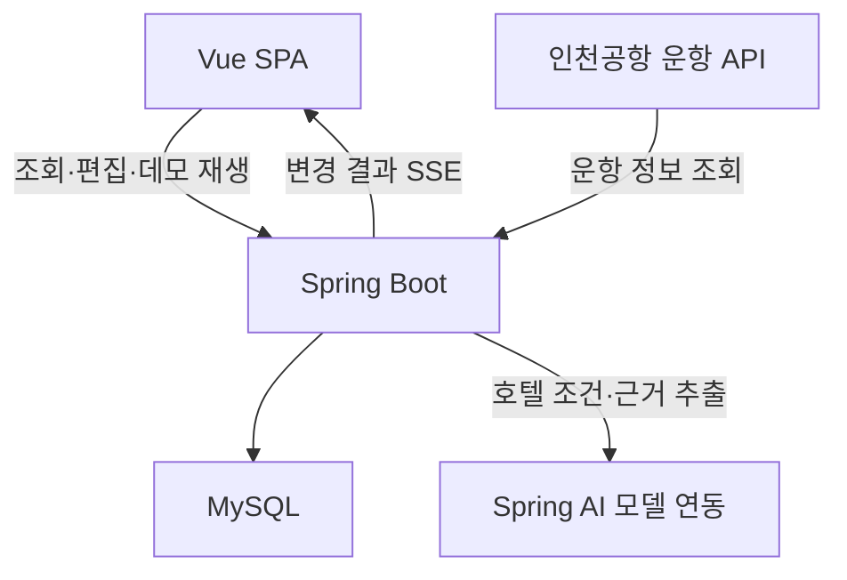

# GateShift 아키텍처

## 시스템 구성

Spring Boot 애플리케이션 하나로 시작한다. Java 21과 Spring Boot 3.5, Vue 3와 TypeScript 및 Vite, MySQL 8.4를 사용한다. 서버 패키지는 여행, 운항, 공항, 호텔, 영향 분석을 기준으로 구성한다. 영속화는 JPA, 스키마 변경은 Flyway로 관리한다. 로컬에서는 Docker Compose로 세 서비스를 띄우고 Nginx가 화면과 API를 동일 출처로 제공한다.

MVP는 단일 백엔드에서 변경 이력을 MySQL 트랜잭션으로 저장하고 커밋 후 SSE로 알린다. 외부 호출 캐시를 여러 인스턴스가 공유하게 되면 Redis를, 별도의 소비 서비스가 운항 이벤트를 독립적으로 재처리해야 하면 Kafka를 검토한다.

## 데이터와 책임

| 데이터 | 저장·처리 기준 |
| --- | --- |
| 여행·할 일 | 편명·출발일, 현재 구역, 사용자의 우선순위, 예상 소요 시간을 저장한다. 브라우저 세션별로 조회와 편집을 제한한다. |
| 운항 스냅샷 | 공급자 식별자가 있을 때 이를 사용한다. 조회 시 편명·출발일 및 공동운항 여부를 함께 고려한다. 출발 예정 시각, 항공사가 확인한 탑승 기준 시각, 도착 예정 시각을 별도 필드로 다룬다. |
| 구역·시설 | 구역, 방향별 이동시간, 게이트, 시설 운영시간을 시드로 관리한다. 추정 시간에는 추정 상태를 표시한다. |
| 호텔 조건 | 호텔 현지 시간대, 확정한 마감, 예외, 근거 문구, 도착 후 이동시간을 저장한다. 예약번호와 여권 정보는 입력 항목에서 제외한다. |
| 변경·판단 이력 | 입력의 전후 값과 변경한 판단, 시각, 출처를 남긴다. 데모 데이터와 실조회 데이터는 화면과 저장에서 구분한다. |

### 공항 동선

시작 구역에서 시설을 거쳐 탑승구에 도착하는 데 필요한 시간을 비교한다. 경로 시간은 방향이 있는 구역 그래프의 최단 경로로 계산한다. 최대 두 가지 할 일의 순서를 비교하면서 영업시간, 체류 시간, 여유 시간을 함께 적용한다. 경유가 불가능하거나 시간 정보가 부족한 경우 각각의 이유를 화면에 노출한다.

### 호텔 정책 추출

Spring AI는 호텔 안내문에서 마감 시각, 사전 연락 예외, 근거 후보를 구조화한다. 원문에서 확인 가능한 근거를 보여주고, 이용자가 확인하거나 수정한 조건을 적용한다. 마감 비교는 서버에서 호텔 현지 시간대로 계산한다. 모델 실패나 조건 누락 시 수동 입력으로 진행한다.

## 변경 감지와 재평가

| 변경된 입력 | 재평가 범위 |
| --- | --- |
| 탑승구, 탑승 기준 시각, 현재 구역, 할 일 | 공항 동선과 탑승 전 행동 |
| 도착 예정 시각, 호텔 조건, 도착 후 이동시간 | 호텔 체크인 판단 |
| 출발 예정 시각 | 운항 카드 갱신. 탑승 기준 시각을 별도로 확인할 때까지 기존 기준과 확인 필요 상태를 표시 |

동일한 운항 값을 반복 조회하면 새 이벤트를 추가하지 않는다. 판단 계산과 이력 저장이 성공한 뒤 SSE로 변경 알림을 보낸다. 재연결 시 Vue가 최신 상태를 한 번 더 조회한다. 외부 호출이 실패하면 마지막 확인값과 확인 시각을 표시한다.

### 외부 데이터

- [인천공항 운항 현황 상세 조회](https://www.data.go.kr/data/15140153/openapi.do)에서 편명, 운항 상태, 게이트, 예정·변경 시각을 조회할 계획이다. 문서상 개발 계정은 일 500회다. API 키는 서버에서만 사용하고, 승인 후 실제 응답과 조회 범위를 확인한다.
- [인천공항 공식 시설 안내](https://www.airport.kr/ap_ko/1008/subview.do)와 [출국 안내](https://www.airport.kr/ap_ko/886/subview.do)를 기준으로 표본과 구역 제약을 확인한다.
- 도착 예정 시각과 탑승 기준 시각은 출발 피드에 없는 경우 시나리오 이벤트나 사용자 확인값으로 받는다. 실제 연결이 확인된 필드만 실조회로 표시한다.
